<div align="center">

# 🛡️ Week 2 — Footprinting & Network Scanning
### Networkwalks Cybersecurity Internship 2026 · Batch B084

**Junaideen Risny Suha** · Cybersecurity Intern


📄 **[Read the full pentest report (PDF)](report/W2-PM-FINAL_Pentest_Report_Junaideen_Risny_Suha_B084.pdf)** · [DOCX version](report/W2-PM-FINAL_Pentest_Report_Junaideen_Risny_Suha_B084.docx)

</div>

---

## 📌 What this project covers

| Module | Task | Status |
|---|---|---|
| **W2-PM1** | Footprint **networkwalks.com** with 6 tools: `whois`, `whatweb`, `nslookup`, `curl -I`, `wafw00f`, `dnsrecon` | ✅ Done |
| **W2-PM5** | **Zenmap** host discovery on my own LAN: live hosts, IPs, MACs, topology PDF | ✅ Done |
| **W2-PM-FINAL** | Professional penetration-testing report covering both phases | ✅ Done |

> **Scope:** networkwalks.com (authorized for interns by Networkwalks) and my own LAN only. Passive / light recon and ping-scan host discovery only — **no exploitation**.

---

## 🔎 Phase 1 — Footprinting networkwalks.com (W2-PM1)

| # | Tool | Command | What it revealed |
|---|---|---|---|
| 1 | WHOIS | `whois networkwalks.com` | Registrar **GoDaddy**, created **2019-11-06**, expires **2027-11-06**, name servers **HostGator**, registrar lock ON, **DNSSEC unsigned** |
| 2 | WhatWeb | `whatweb networkwalks.com` | **Apache**, **WordPress 7.1.4**, **WP Download Manager 3.3.76**, jQuery 3.7.1, email `info@networkwalks.com` |
| 3 | Nslookup | `nslookup networkwalks.com` | A record → **192.232.216.135** |
| 4 | cURL | `curl -sI https://networkwalks.com` | `Server: Apache`, nginx cache, **`/wp-json/` REST API**, secure+HttpOnly cookie, **no HSTS / CSP / X-Frame-Options** |
| 5 | Wafw00f | `wafw00f https://networkwalks.com` | Behind **ModSecurity (SpiderLabs) WAF** |
| 6 | DNSRecon | `dnsrecon -d networkwalks.com` | SOA/NS HostGator, **MX on the same IP as the website**, SPF `~all`, 8 cPanel SRV records, DNSSEC not configured |

<details>
<summary><b>📸 Show all 6 footprinting screenshots</b></summary>

**1. whois**
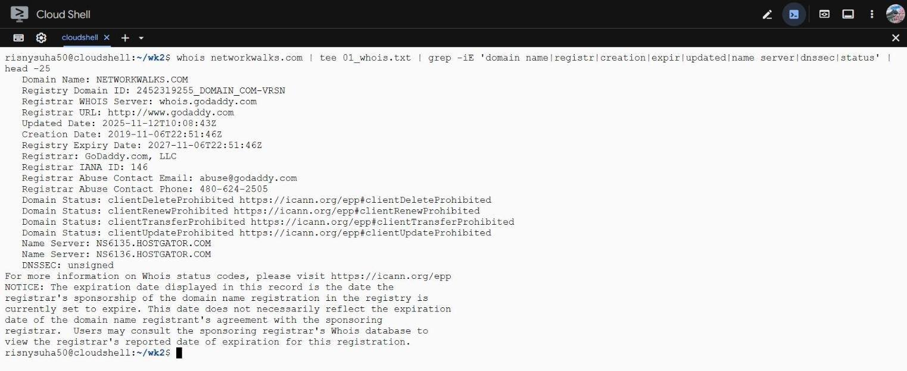

**2. whatweb**
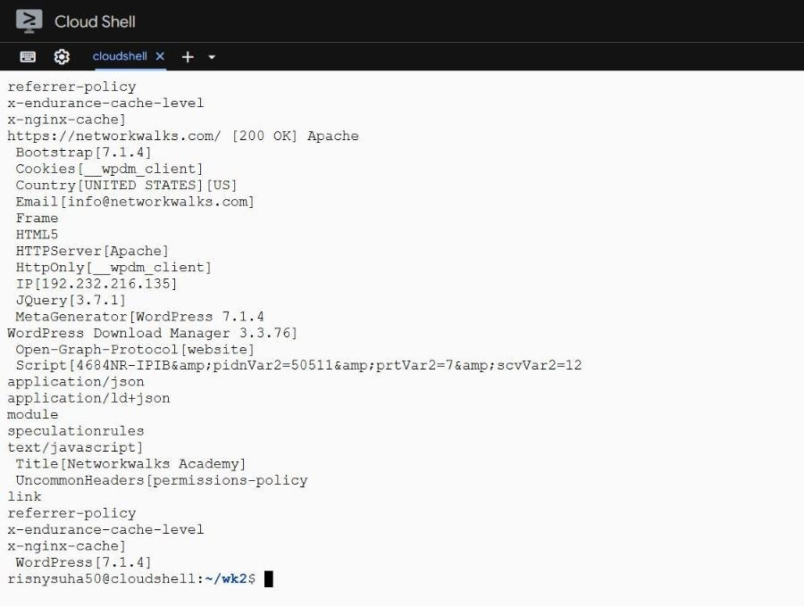

**3. nslookup**
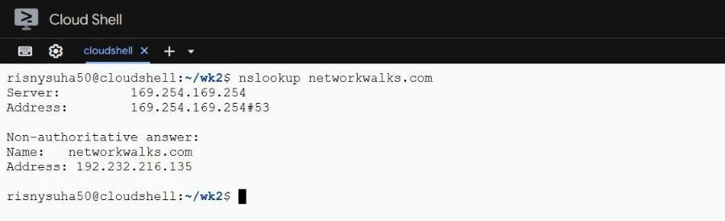

**4. curl -I**
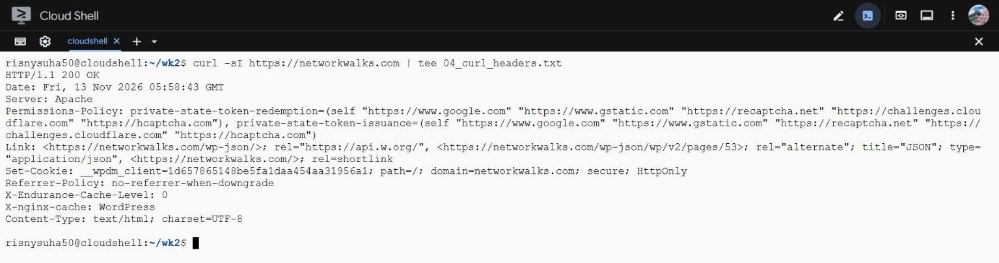

**5. wafw00f**
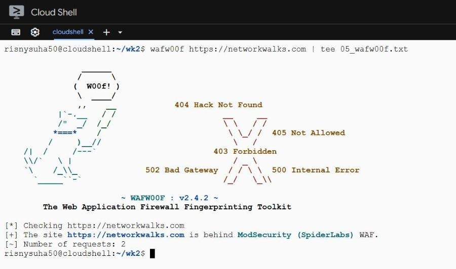

**6. dnsrecon**
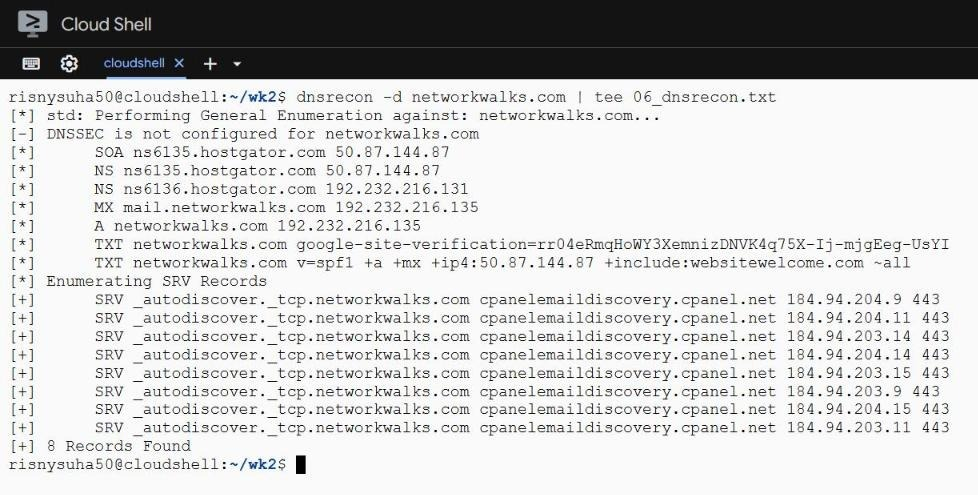

</details>

Full raw outputs are in [`outputs/`](outputs/).

### 🆕 What changed since the instructor's guide
Running the tools live showed the target had been **patched** since the module guide was written:

| Item | Module guide | My scan (13 Nov 2026) |
|---|---|---|
| WordPress | 7.0.4 | **7.1.4** |
| WP Download Manager | 3.3.58 | **3.3.76** |
| DNS software version | Bind 9.16.23 shown | **No longer disclosed** |

👉 Lesson: footprinting is a snapshot. It must be repeated before every engagement.

---

## 🌐 Phase 2 — Network Scanning with Zenmap (W2-PM5)

| Task | Answer |
|---|---|
| 1. Install Zenmap | Nmap / Zenmap **7.993** from the official nmap.org installer |
| 2. My IP & subnet | IP **192.168.8.102**, mask **255.255.255.0** → subnet **192.168.8.0/24**, gateway **192.168.8.1** |
| 3. Live hosts | Zenmap **Ping scan** → `nmap -sn 192.168.8.0/24` |
| 4. How many live? | **3 hosts** (including my PC), 256 addresses scanned in 5.68 s |
| 5 & 6. IPs + MACs | see table below |
| 7. Topology PDF | Saved with **Save Graphic → PDF** (legend on) |

| IP address | MAC address | Device |
|---|---|---|
| 192.168.8.1 | `94:0E:6B:C0:1A:AF` | Huawei home router / gateway (`homerouter.cpe`) |
| 192.168.8.101 | `FE:82:03:B8:34:C9` | Randomized private MAC (likely a phone) |
| 192.168.8.102 | `D4:6D:6D:72:CF:27` | My Windows PC (scanner) |

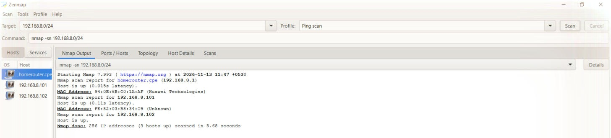
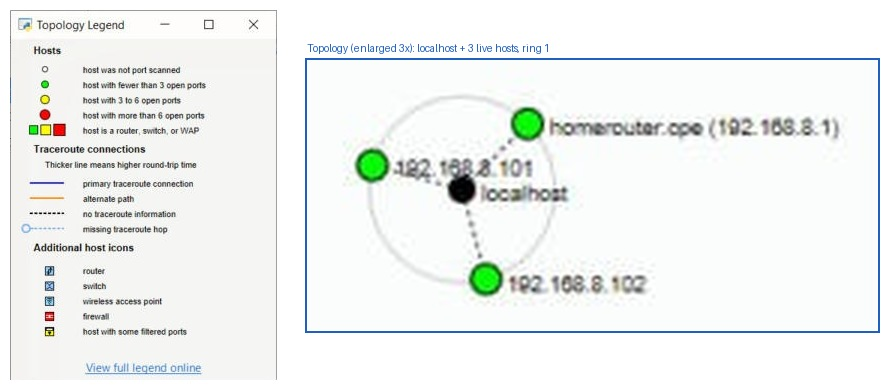

<details>
<summary><b>📸 More Zenmap evidence</b></summary>

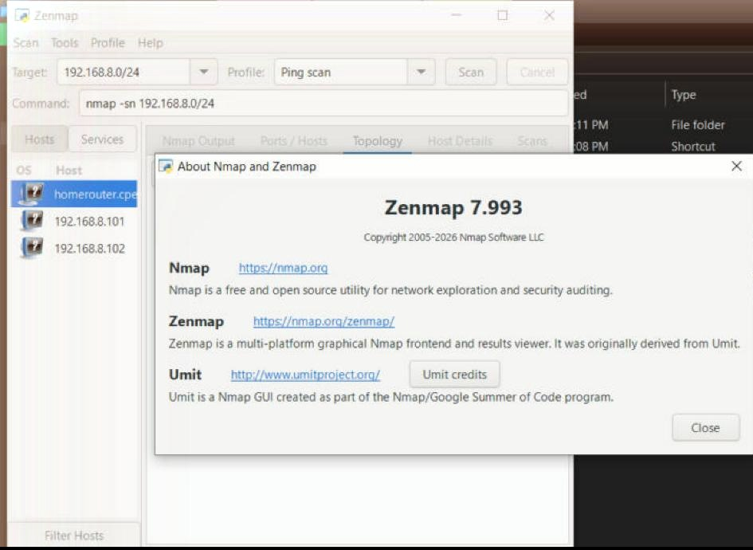
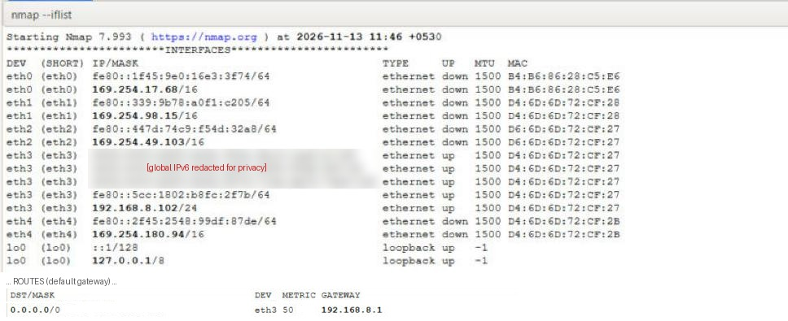
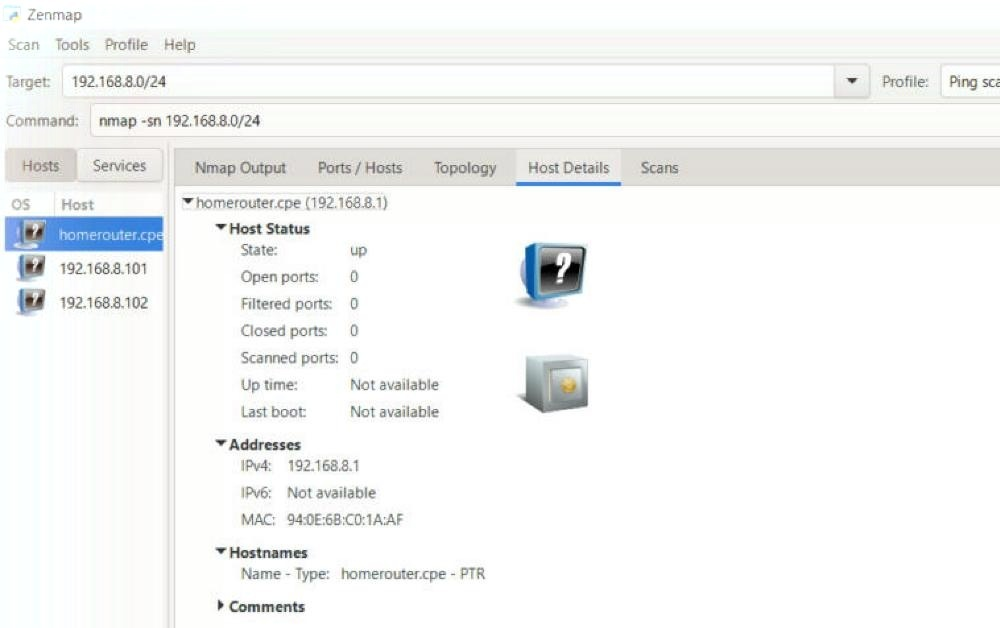

</details>

---

## ⚠️ Risk summary

| Finding | Risk |
|---|---|
| CMS & plugin versions disclosed | 🟠 Medium |
| Browser security headers missing (HSTS, CSP, XFO, XCTO) | 🟠 Medium |
| DNSSEC not enabled | 🟠 Medium |
| Soft SPF policy (`~all`) | 🟠 Medium |
| Web and mail on the same host | 🟢 Low |
| WordPress REST API exposed | 🟢 Low |
| Public contact email | 🟢 Low |
| ModSecurity WAF in place | 🔵 Positive control |

These are observations from passive recon, not confirmed vulnerabilities. Full analysis and recommendations are in the [report](report/W2-PM-FINAL_Pentest_Report_Junaideen_Risny_Suha_B084.pdf).

---

## 🧰 Troubleshooting share

**Issue:** My laptop with the Week 1 Kali Linux VM was away for repair during Week 2.
**Fix:** I installed the exact same tools on a Debian Linux terminal (Google Cloud Shell): `apt install whois whatweb dnsutils` and `pip install --user wafw00f dnsrecon`.
**Gotcha:** `wafw00f: command not found` → pip `--user` installs into `~/.local/bin`, so add it to PATH: `export PATH=$HOME/.local/bin:$PATH`.
**Zenmap tip:** No CMD needed for Task 2. Run `nmap --iflist` in Zenmap's Command box to get your IP, subnet mask, MAC and default gateway in one view.

---

## 📁 Repository structure

```
├── README.md
├── report/      → W2-PM-FINAL pentest report (PDF + DOCX)
├── evidence/    → screenshots for every task (PM1 × 6, PM5 × 5)
└── outputs/     → raw text output of every command
```

---

<div align="center">

⚖️ *For educational purposes only. All testing stayed inside the authorized scope of the Networkwalks Cybersecurity Internship.*

**Junaideen Risny Suha** · [LinkedIn](https://linkedin.com/in/risny-suha-8a6b66423) · [GitHub](https://github.com/DevRisny)

Thanks to **Networkwalks** and instructor **Waqas Karim (CCIE)**.

</div>
